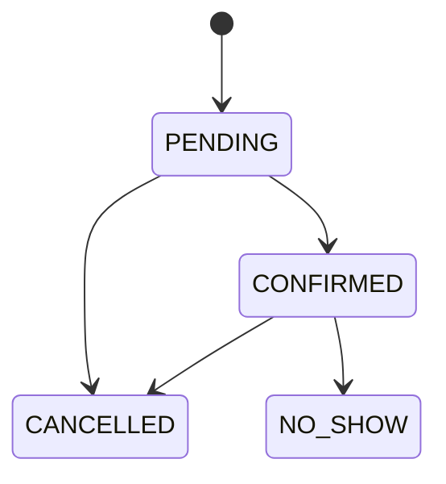

# Reservas API

[](https://github.com/manuelcarro97/reservas-api/actions/workflows/ci.yml)

API REST de reservas de mesa para restaurantes. Comprueba la disponibilidad por turno, asigna mesa y garantiza que una mesa no se reserva dos veces, también cuando dos personas piden la última a la vez.

## Stack

Java 21, Spring Boot 4.1, Spring Data JPA, Spring Security, PostgreSQL 17, Flyway, JUnit 5, Testcontainers, springdoc-openapi, Docker Compose y GitHub Actions.

## Cómo ejecutar

Requiere Docker.

```bash
cp .env.example .env
docker compose up --build
```

La API queda en `http://localhost:8080`, con Swagger en `http://localhost:8080/swagger-ui/index.html`. El perfil `demo` carga un restaurante ficticio con slug `demo`.

La gestión (`/api/v1/admin/**`) no usa usuario y contraseña propios: pide un token de Firebase Authentication en la cabecera `Authorization: Bearer <token>`. El contrato de la API está congelado en [`contracts/openapi.json`](contracts/openapi.json).

### Variables de entorno

Todas son opcionales y tienen un valor por defecto pensado para local. Los secretos nunca van en el repo: solo por variable de entorno, en un `.env` local (fuera de git) o en el panel del hosting. `docker compose` solo pasa al contenedor `api` las variables de base de datos y el perfil que fija `compose.yaml`; para el resto, añádelas a su `environment` o expórtalas antes de arrancar con `./mvnw spring-boot:run` o `java -jar`.

| Variable | Para qué sirve | Secreto | Por defecto |
|---|---|---|---|
| `SPRING_PROFILES_ACTIVE` | Perfiles de Spring. `demo` activa la cuenta y el plano de demostración (compose ya lo pone). | No | vacío |
| `SPRING_DATASOURCE_URL` | URL JDBC de PostgreSQL, por ejemplo `jdbc:postgresql://localhost:5432/reservas`. | No | sin valor: obligatoria fuera de compose |
| `SPRING_DATASOURCE_USERNAME` | Usuario de la base de datos. | No | sin valor |
| `SPRING_DATASOURCE_PASSWORD` | Contraseña de la base de datos. | Sí | sin valor |
| `POSTGRES_DB`, `POSTGRES_USER`, `POSTGRES_PASSWORD` | Solo para `docker compose`: crean la base y alimentan las tres variables anteriores. | `POSTGRES_PASSWORD` sí | sin valor: salen de `.env` |
| `PORT` | Puerto HTTP de la API. | No | `8080` |
| `FORWARD_HEADERS_STRATEGY` | Cómo se obtiene la IP del cliente para el límite de peticiones. Con `none` es la del socket. Detrás de un proxy usa `native` y solo con los proxies internos del proveedor; nunca `framework`, porque toma el valor de `X-Forwarded-For` que escribe el cliente. En Render va a `native` ([`DEPLOY.md`](DEPLOY.md)). | No | `none` |
| `JAVA_TOOL_OPTIONS` | Opciones de la JVM. Solo la imagen Docker la define: heap al 60 % del límite del contenedor, GC serie y solo el compilador C1, para 512 MB (ver `Dockerfile`). Si la defines, sustituye a la de la imagen entera. | No | las del `Dockerfile` |
| `CORS_ALLOWED_ORIGINS` | Orígenes del frontend que pueden llamar a la API, separados por comas. | No | `http://localhost:4200` |
| `FIREBASE_PROJECT_ID` | Proyecto de Firebase que emite los tokens que acepta la API. | No | `reservas-6d51b` |
| `FIREBASE_SERVICE_ACCOUNT_JSON` | JSON completo de la cuenta de servicio de Firebase. Con él, borrar una cuenta borra también su usuario de Firebase y se restaura la contraseña de la demo. Sin él, solo se deja constancia en el log. | Sí | vacío |
| `TELEGRAM_BOT_TOKEN` | Token del bot de Telegram (BotFather). Con el nombre del bot activa los avisos al dueño y la vinculación; sin los dos, los avisos van al log. | Sí | vacío |
| `TELEGRAM_BOT_USERNAME` | Nombre del bot, sin `@`. Hace falta junto al token. | No | vacío |
| `DEMO_ENABLED` | Siembra la cuenta y el plano de demostración al arrancar y cada noche. El perfil `demo` ya lo activa. | No | `false` |
| `DEMO_UID` | Identificador fijo del dueño de la demo. | No | `demo-owner` |
| `DEMO_EMAIL` | Email de la cuenta demo en Firebase. Sin él (o sin contraseña) se siembra el plano pero no se toca la cuenta. | No | vacío |
| `DEMO_PASSWORD` | Contraseña de la cuenta demo en Firebase. | Sí | vacío |

Limitación conocida: tras borrar una cuenta, su token de Firebase sigue siendo válido hasta unos 60 minutos, porque la API lo valida sin consultar a Firebase.

Cualquier otra propiedad de Spring Boot también se puede fijar por variable de entorno con su nombre en mayúsculas y guiones bajos.

## Ejemplos

```bash
# Fecha de ejemplo dentro de la ventana de reserva
FECHA=$(date -d '+7 days' +%F)

# Consultar turnos
curl "http://localhost:8080/api/v1/restaurants/demo/availability?date=$FECHA&partySize=2"

# Reservar
curl -X POST http://localhost:8080/api/v1/restaurants/demo/reservations \
  -H "Content-Type: application/json" \
  -d "{\"date\":\"$FECHA\",\"shiftId\":2,\"partySize\":2,\"customerName\":\"Ana\",\"customerPhone\":\"600000000\"}"

# Consultar o cancelar con el código recibido
curl http://localhost:8080/api/v1/reservations/CODIGO
curl -X POST http://localhost:8080/api/v1/reservations/CODIGO/cancel

# Gestión: lista del día, con el token de Firebase del dueño
curl -H "Authorization: Bearer $TOKEN" "http://localhost:8080/api/v1/admin/restaurants/demo/reservations?date=$FECHA"
```

## Reglas de negocio

- El cliente indica personas y turno. El sistema asigna la mesa libre más pequeña que le sirve.
- No se aceptan turnos ya empezados, fechas a más de 90 días, días de cierre, turnos que no abren ese día ni grupos mayores que la mesa más grande.
- Los turnos de un local no pueden solaparse, porque la mesa se reserva por turno.
- No se puede cerrar un día con reservas activas: primero hay que cancelarlas.
- Una reserva solo se confirma antes de que empiece su turno. Las que siguen pendientes entonces se cancelan solas.
- Las fechas y horas se evalúan en la zona horaria de cada local.
- El cliente puede cancelar hasta el plazo del local. El administrador puede cancelar después.



## Cómo evita el overbooking

La garantía está en PostgreSQL, en un índice único parcial:

```sql
CREATE UNIQUE INDEX uq_reservation_active_slot
    ON reservation (table_id, reservation_date, shift_id)
    WHERE status IN ('PENDING', 'CONFIRMED');
```

Cada reserva se inserta con `ON CONFLICT DO NOTHING`. Si otra petición ganó esa mesa, se prueba la siguiente; si no queda ninguna, la API responde 409. Cancelar libera la mesa porque la reserva deja de cumplir el filtro del índice. El motivo está en [ADR 0002](adr/0002-overbooking-indice-parcial.md).

`OverbookingConcurrencyIT` lanza 20 peticiones simultáneas contra PostgreSQL real y comprueba que nunca se reservan más mesas de las que hay.

## Arquitectura

Hexagonal: `domain` no depende de Spring ni de JPA, `application` define los casos de uso y sus puertos, y `adapter` implementa HTTP y persistencia. Ver [ADR 0001](adr/0001-hexagonal.md).

Las mesas guardan su posición (`x`, `y`, el centro de la mesa), y el endpoint de ocupación la devuelve para que un cliente pueda dibujar un plano.

## Tests

```bash
./mvnw verify
```

Los tests `*Test` son unitarios y los `*IT` usan PostgreSQL real con Testcontainers, por lo que requieren Docker.

## Despliegue

La API se publica en Render (plan gratuito, Docker, `render.yaml`), el frontend en Firebase Hosting (`firebase.json`) y la base de datos en Neon. Los pasos, las variables que hay que pegar en Render y las comprobaciones posteriores están en [`DEPLOY.md`](DEPLOY.md).

## Límites de la v1

Sin juntar mesas, turnos que cruzan medianoche, emails ni pagos. El límite de peticiones es en memoria y de una sola instancia: por IP en las altas de reserva (10 por minuto) y en las consultas y cancelaciones por código (30 por minuto), y por usuario en las escrituras de la gestión. Hay un único administrador global.

La comprobación de turnos solapados y de reservas al cerrar un día se hace en la aplicación, no en la base de datos: dos operaciones exactamente simultáneas podrían saltársela. Con un único administrador, el riesgo es asumible.

La gestión usa HTTP Basic sin protección CSRF, pensada para `curl` o Swagger. Un panel en navegador necesitaría sesión o tokens con esa protección.

## Licencia

[MIT](LICENSE)
