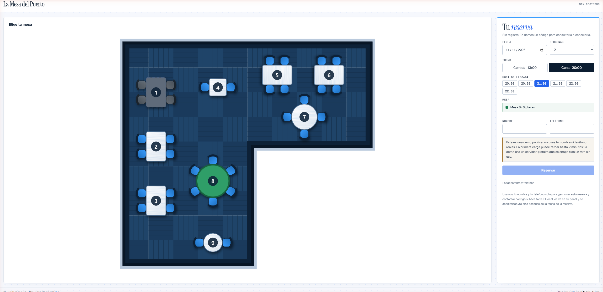
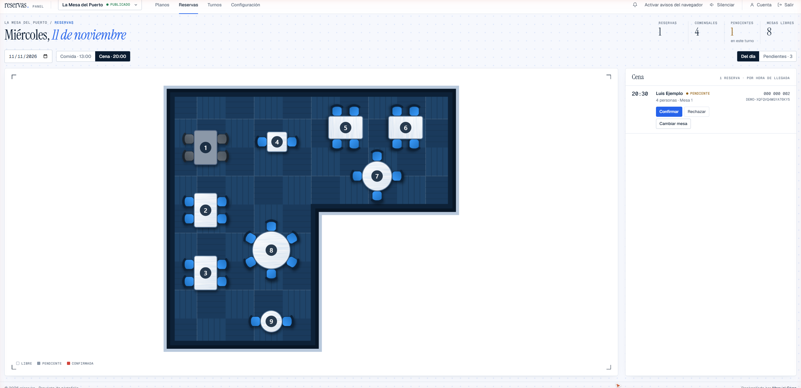
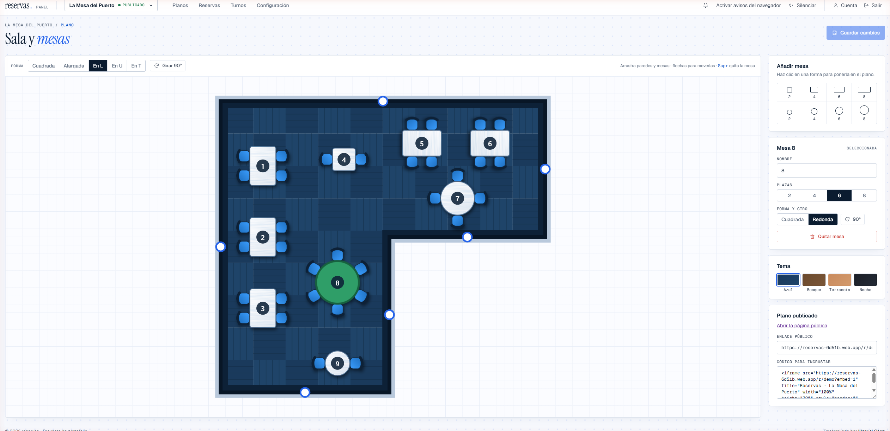
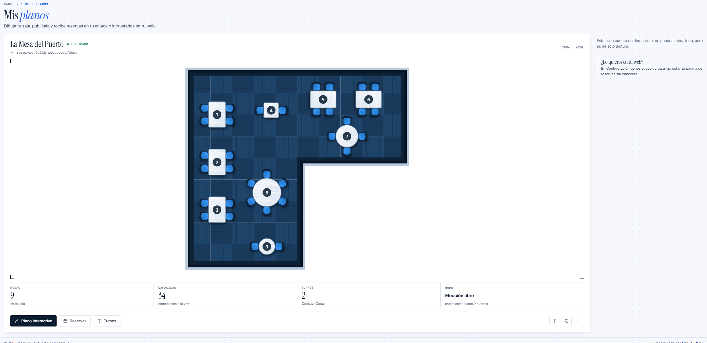
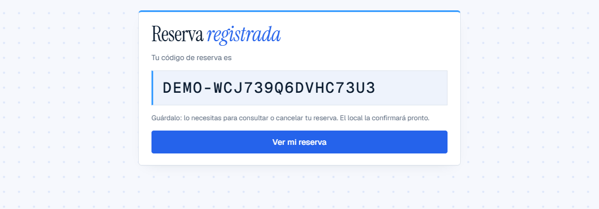
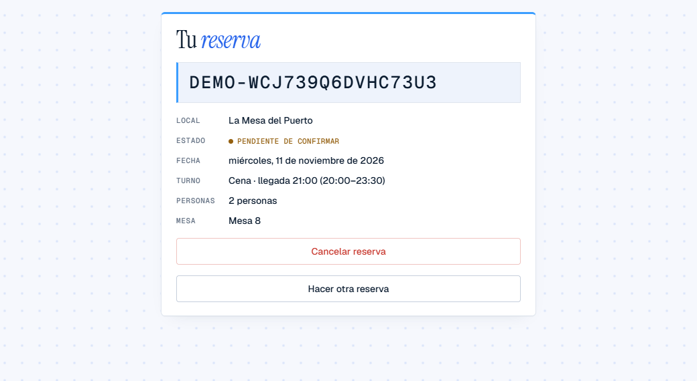
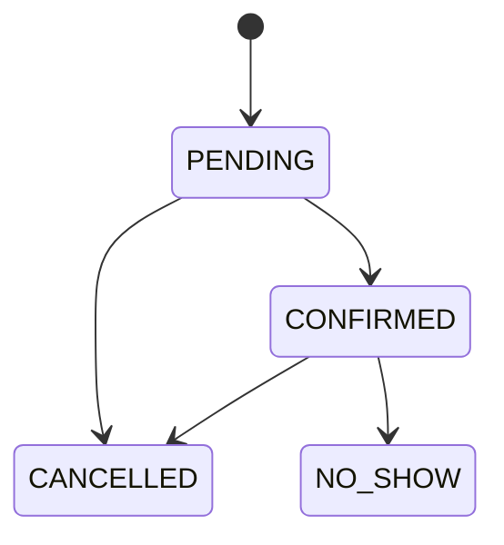

# reservas.

[](https://github.com/manuelcarro97/reservas/actions/workflows/ci.yml)

Reservas de mesa para restaurantes. El dueño dibuja su sala, la publica y recibe reservas en un enlace propio o incrustadas en su web. El cliente elige turno, hora y mesa en el plano real, sin registrarse. Una mesa nunca se reserva dos veces, ni siquiera cuando dos personas piden la última a la vez.

**Demo en línea**

- Página de reservas: <https://reservas-6d51b.web.app/r/demo>
- Panel del dueño: <https://reservas-6d51b.web.app/entrar>, con la cuenta demo `demo@example.com` / `ReservasDemo2026.` (el botón "Rellenar" la pone por ti).

> La API está en el plan gratuito de Render y se apaga tras un rato sin uso: la primera carga puede tardar hasta 2 minutos. La demo se restaura cada noche, así que lo que cambies en ella no dura.

| Reserva del cliente | Reservas del día |
|---|---|
|  |  |
| **Editor de la sala** | **Mis planos** |
|  |  |
| **Código de reserva** | **Consultar o cancelar** |
|  |  |

## Qué hace

**El cliente**, sin crear cuenta:

- Reserva en `/r/<local>`: fecha, personas, turno, hora de llegada y, si el local lo permite, la mesa en el plano.
- Recibe un código con el que consulta o cancela su reserva en `/reserva/<código>` dentro del plazo del local.
- La misma página se puede incrustar en la web del restaurante con un `<iframe>` (`?embed=1` quita la cabecera).

**El dueño**, con cuenta (correo o Google):

- Dibuja hasta 3 planos: forma de la sala (cuadrada, rectangular, en L, en U o en T), mesas redondas o cuadradas de 2, 4, 6 u 8 plazas, giro y tema de color.
- Ve las reservas del día sobre el plano: confirma, rechaza, cambia o asigna mesa, marca "no presentado" y escribe al cliente por WhatsApp.
- Define turnos por día de la semana, cierra días concretos y elige el modo de reserva: el cliente elige mesa o la asigna el local.
- Recibe avisos de reservas nuevas en el panel (con sonido y notificación del navegador) y, si lo vincula, por Telegram.

**Privacidad**: los datos del cliente (nombre y teléfono) se anonimizan 30 días después de la reserva.

## Stack

| Parte | Tecnología |
|---|---|
| API | Java 21, Spring Boot 4.1, Spring Security (JWT de Firebase), Spring Data JPA, PostgreSQL 17, Flyway, springdoc-openapi |
| Frontend | Angular 22 (standalone, signals, sin zone.js), cliente generado desde el contrato OpenAPI con ng-openapi-gen, plano en SVG propio |
| Autenticación | Firebase Authentication (correo y Google). La API valida los tokens; la página pública no carga Firebase |
| Tests | JUnit 5, Testcontainers con PostgreSQL real, Vitest |
| Infraestructura | Docker, GitHub Actions, Render (API), Firebase Hosting (frontend), Neon (PostgreSQL) |

## Estructura

```
src/          API Spring Boot (hexagonal)
frontend/     Angular: página pública de reservas y panel del dueño
contracts/    openapi.json, el contrato del que se genera el cliente del frontend
adr/          decisiones de arquitectura
```

**API**: hexagonal. `domain` no depende de Spring ni de JPA, `application` define los casos de uso y sus puertos, y `adapter` implementa HTTP, persistencia, Firebase y Telegram. Ver [ADR 0001](adr/0001-hexagonal.md).

**Frontend**: el shell público y el panel van en chunks separados. La página de reservas (la que se incrusta) no descarga Firebase ni código del panel. El contrato de la API está congelado en [`contracts/openapi.json`](contracts/openapi.json); si cambia, el cliente del frontend se regenera y el compilador marca lo que hay que tocar.

## Cómo evita el overbooking

La garantía está en PostgreSQL, en un índice único parcial:

```sql
CREATE UNIQUE INDEX uq_reservation_active_slot
    ON reservation (table_id, reservation_date, shift_id)
    WHERE status IN ('PENDING', 'CONFIRMED');
```

Cada reserva se inserta con `ON CONFLICT DO NOTHING`. Si otra petición ganó esa mesa, la API responde 409 (o prueba la siguiente mesa, si la asigna el local). Cancelar libera la mesa porque la reserva deja de cumplir el filtro del índice. El motivo está en [ADR 0002](adr/0002-overbooking-indice-parcial.md).

`OverbookingConcurrencyIT` lanza 20 peticiones simultáneas contra PostgreSQL real y comprueba que nunca se reservan más mesas de las que hay.

## Reglas de negocio

- No se aceptan turnos ya empezados, fechas a más de 90 días, días de cierre, turnos que no abren ese día ni grupos mayores que la mesa más grande.
- Las horas de llegada se ofrecen cada 30 minutos, desde el inicio del turno hasta una hora antes del final.
- Los turnos de un local no pueden solaparse, porque la mesa se reserva por turno.
- No se puede cerrar un día con reservas activas: primero hay que cancelarlas.
- Una reserva solo se confirma antes de que empiece su turno. Las que siguen pendientes entonces se cancelan solas.
- Las fechas y horas se evalúan en la zona horaria de cada local.
- El cliente puede cancelar hasta el plazo del local. El dueño puede cancelar después.



## Cómo ejecutar en local

Requiere Docker y Node 24.

```bash
# API y PostgreSQL, con la demo cargada
cp .env.example .env
docker compose up --build

# Frontend, en otra terminal
cd frontend
npm ci
npm start
```

La API queda en `http://localhost:8080` (Swagger en `/swagger-ui/index.html`) y el frontend en `http://localhost:4200`. La demo pública está en `http://localhost:4200/r/demo`. Para entrar al panel en local hace falta una cuenta del proyecto de Firebase.

La gestión (`/api/v1/admin/**`) pide un token de Firebase Authentication en la cabecera `Authorization: Bearer <token>`.

### Variables de entorno

Todas son opcionales y tienen un valor por defecto pensado para local. Los secretos nunca van en el repo: solo por variable de entorno, en un `.env` local (fuera de git) o en el panel del hosting. `docker compose` solo pasa al contenedor `api` las variables de base de datos y el perfil que fija `compose.yaml`; para el resto, añádelas a su `environment` o expórtalas antes de arrancar con `./mvnw spring-boot:run` o `java -jar`.

| Variable | Para qué sirve | Secreto | Por defecto |
|---|---|---|---|
| `SPRING_PROFILES_ACTIVE` | Perfiles de Spring. `demo` activa la cuenta y el plano de demostración (compose ya lo pone). | No | vacío |
| `SPRING_DATASOURCE_URL` | URL JDBC de PostgreSQL, por ejemplo `jdbc:postgresql://localhost:5432/reservas`. | No | sin valor: obligatoria fuera de compose |
| `SPRING_DATASOURCE_USERNAME` | Usuario de la base de datos. | No | sin valor |
| `SPRING_DATASOURCE_PASSWORD` | Contraseña de la base de datos. | Sí | sin valor |
| `POSTGRES_DB`, `POSTGRES_USER`, `POSTGRES_PASSWORD` | Solo para `docker compose`: crean la base y alimentan las tres variables anteriores. | `POSTGRES_PASSWORD` sí | sin valor: salen de `.env` |
| `PORT` | Puerto HTTP de la API. | No | `8080` |
| `FORWARD_HEADERS_STRATEGY` | Cómo se obtiene la IP del cliente para el límite de peticiones. Con `none` es la del socket. Detrás de un proxy usa `native` y solo con los proxies internos del proveedor; nunca `framework`, porque toma el valor de `X-Forwarded-For` que escribe el cliente. En Render va a `native` ([`DEPLOY.md`](DEPLOY.md)). | No | `none` |
| `JAVA_TOOL_OPTIONS` | Opciones de la JVM. Solo la imagen Docker la define: heap al 60 % del límite del contenedor, GC serie y solo el compilador C1, para 512 MB (ver `Dockerfile`). Si la defines, sustituye a la de la imagen entera. | No | las del `Dockerfile` |
| `CORS_ALLOWED_ORIGINS` | Orígenes del frontend que pueden llamar a la API, separados por comas. | No | `http://localhost:4200` |
| `FIREBASE_PROJECT_ID` | Proyecto de Firebase que emite los tokens que acepta la API. | No | `reservas-6d51b` |
| `FIREBASE_SERVICE_ACCOUNT_JSON` | JSON completo de la cuenta de servicio de Firebase. Con él, borrar una cuenta borra también su usuario de Firebase y se crea y restaura la cuenta demo. Sin él, solo se deja constancia en el log. | Sí | vacío |
| `TELEGRAM_BOT_TOKEN` | Token del bot de Telegram (BotFather). Con el nombre del bot activa los avisos al dueño y la vinculación; sin los dos, los avisos van al log. | Sí | vacío |
| `TELEGRAM_BOT_USERNAME` | Nombre del bot, sin `@`. Hace falta junto al token. | No | vacío |
| `DEMO_ENABLED` | Siembra la cuenta y el plano de demostración al arrancar y cada noche. El perfil `demo` ya lo activa. | No | `false` |
| `DEMO_UID` | Identificador fijo del dueño de la demo. | No | `demo-owner` |
| `DEMO_EMAIL` | Email de la cuenta demo en Firebase. Sin él (o sin contraseña) se siembra el plano pero no se toca la cuenta. | No | vacío |
| `DEMO_PASSWORD` | Contraseña de la cuenta demo en Firebase. | Sí | vacío |

Limitación conocida: tras borrar una cuenta, su token de Firebase sigue siendo válido hasta unos 60 minutos, porque la API lo valida sin consultar a Firebase.

Cualquier otra propiedad de Spring Boot también se puede fijar por variable de entorno con su nombre en mayúsculas y guiones bajos.

### Ejemplos con curl

```bash
# Fecha de ejemplo dentro de la ventana de reserva
FECHA=$(date -d '+7 days' +%F)

# Consultar turnos (la respuesta trae el shiftId de cada uno)
curl "http://localhost:8080/api/v1/restaurants/demo/availability?date=$FECHA&partySize=2"

# Reservar: la demo deja elegir mesa, así que lleva tableId y la hora de llegada
curl -X POST http://localhost:8080/api/v1/restaurants/demo/reservations \
  -H "Content-Type: application/json" \
  -d "{\"date\":\"$FECHA\",\"shiftId\":SHIFT_ID,\"arrivalTime\":\"20:00\",\"tableId\":TABLE_ID,\"partySize\":2,\"customerName\":\"Ana\",\"customerPhone\":\"600000000\"}"

# Consultar o cancelar con el código recibido
curl http://localhost:8080/api/v1/reservations/CODIGO
curl -X POST http://localhost:8080/api/v1/reservations/CODIGO/cancel

# Gestión: lista del día, con el token de Firebase del dueño
curl -H "Authorization: Bearer $TOKEN" "http://localhost:8080/api/v1/admin/restaurants/demo/reservations?date=$FECHA"
```

## Tests

1.410 tests, todos en el CI de cada push a `main`:

| Parte | Tests | Comando |
|---|---|---|
| API, unitarios (`*Test`) | 225 | `./mvnw test` |
| API, integración (`*IT`, PostgreSQL real con Testcontainers; requieren Docker) | 444 | `./mvnw verify` |
| Frontend (Vitest) | 741 | `cd frontend && npm test` |

## Despliegue

La API se publica en Render (plan gratuito, Docker, [`render.yaml`](render.yaml)), el frontend en Firebase Hosting ([`firebase.json`](firebase.json), con CSP y cabeceras por ruta: solo `/r/**` y `/reserva/**` se pueden incrustar) y la base de datos en Neon. Los pasos, las variables que hay que pegar en Render y las comprobaciones posteriores están en [`DEPLOY.md`](DEPLOY.md).

## Límites

- Sin juntar mesas, turnos que cruzan medianoche, emails ni pagos.
- El límite de peticiones es en memoria y de una sola instancia: por IP en las altas de reserva (10 por minuto) y en las consultas y cancelaciones por código (30 por minuto), y por usuario en las escrituras de la gestión (60 por minuto).
- La comprobación de turnos solapados y de reservas al cerrar un día se hace en la aplicación, no en la base de datos: dos operaciones exactamente simultáneas del mismo dueño podrían saltársela. Con un dueño por local, el riesgo es asumible.
- Diseño pensado para escritorio. En pantallas de menos de 1024 px las columnas se apilan, pero aún no hay un diseño móvil propio.

## Licencia

[MIT](LICENSE)

---

Desarrollado por [Manuel Carro](https://github.com/manuelcarro97).
